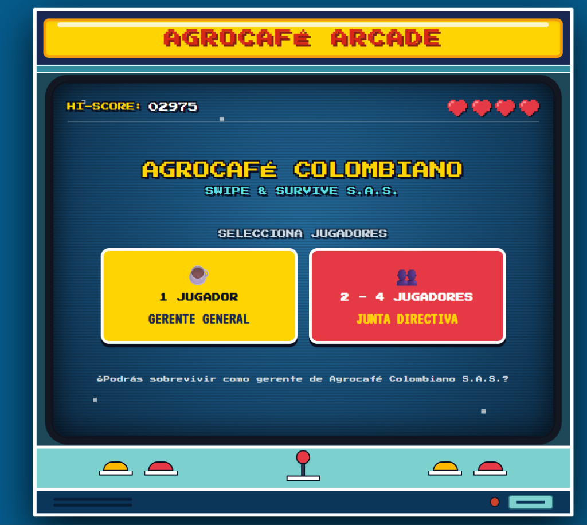
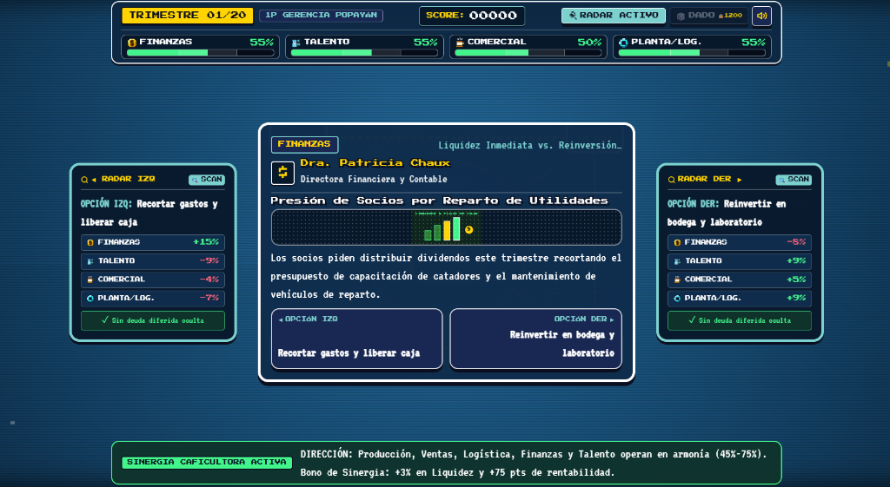

# Swipe & Survive: AgroCafé Colombiano S.A.S.

Un simulador de toma de decisiones estratégicas con estética **Retro Arcade** ambientado en la ciudad de Popayán, Colombia.

Ponte en los zapatos de la gerencia de **AgroCafé Colombiano S.A.S.**, una empresa agroindustrial de 80 trabajadores dedicada a la compra de café pergamino a pequeños productores campesinos, trilla, tueste y distribución nacional e internacional.

Tu misión es **sobrevivir 20 trimestres (5 años)** manteniendo en equilibrio las diferentes áreas de la empresa ante los retos del mercado, la logística y el entorno colombiano.

---

## Vistazo al Juego

### Pantalla de Inicio (Gabinete Arcade)
Elige jugar en solitario como Gerente General o en equipo con amigos asumiendo los roles de la Junta Directiva.



### Simulador y Toma de Decisiones
Analiza las propuestas de cada área, revisa los pronósticos y decide deslizando hacia la izquierda o hacia la derecha.



---

## Mecánicas Principales

### 1. Las 4 Barras de Salud de la Empresa
Cada decisión altera el balance de la organización. **Si cualquiera de estas 4 barras llega a 0%, la empresa quiebra:**
* 💰 **Finanzas:** Dinero en caja, presupuesto para comprar café y solvencia.
* 👥 **Talento Humano:** Clima laboral, salud y motivación de los 80 trabajadores.
* ☕ **Comercial:** Ventas en supermercados, cafeterías de especialidad y clientes digitales.
* ⚙️ **Planta y Logística:** Maquinaria de trilla y tueste, bodegas y transporte por carretera.

> **Regla de oro:** Mantener todas las barras entre el 35% y el 75% te otorga bonos de equilibrio y puntos extra en cada trimestre.

### 2. Decisiones con Consecuencias Reales
En cada turno recibes una tarjeta con un dilema presentado por los jefes de área. Las decisiones fáciles o apresuradas pueden ahorrar dinero hoy, pero generar problemas graves que estallarán 3 trimestres después (como máquinas averiadas o paros laborales).

### 3. Radar de Pronóstico
Dispones de **3 usos de Radar** durante la partida. Al activarlo, verás con exactitud cuánto subirá o bajará cada barra antes de tomar la decisión, revelando si hay trampas o deudas ocultas.

### 4. Choques y Crisis del Entorno Caucano
En momentos clave de la partida ocurrirán eventos imprevistos basados en la realidad de Popayán y Colombia:
* Cierres viales o derrumbes en la Vía Panamericana.
* Mingas indígenas o bloqueos en la variante norte.
* Paros de transporte hacia el puerto marítimo de Buenaventura.
* Alzas históricas del dólar (TRM) y cotización en la Bolsa de Nueva York.
* Cortes imprevistos de energía en la zona industrial o brotes de plagas por lluvias.

### 5. El Dado de la Suerte (Eventos Fortuitos 🎲)
Al alcanzar **1.200 puntos**, desbloquearás un **Dado de la Suerte**. Puedes reservarlo y lanzarlo en cualquier turno crítico para activar uno de 6 sucesos sorpresa (como donaciones de maquinaria suiza, clima perfecto en la meseta o tendencias virales en redes sociales).

### 6. Modos de Juego
* **1 Jugador (Gerente General):** Tomas todas las decisiones de forma individual.
* **2 a 4 Jugadores (Junta Directiva):** Cada jugador se turna para liderar un trimestre específico según su área asignada (Finanzas, Talento, Comercial u Operaciones).

---

## 💻 Requisitos del Sistema

* **Node.js:** Versión 18.0 o superior instalada.
* **Gestor de paquetes:** `pnpm` (obligatorio para este proyecto).

---

## 🚀 Instalación y Puesta en Marcha

Sigue estos sencillos pasos en tu terminal para ejecutar el juego en tu computador:

1. **Clonar o descargar este repositorio:**
   ```bash
   git clone <url-del-repositorio>
   cd SwipeAndSurvive
   ```

2. **Instalar dependencias con `pnpm`:**
   ```bash
   pnpm install
   ```

3. **Iniciar el servidor de desarrollo local:**
   ```bash
   pnpm dev
   ```
   Abre el enlace que aparece en la terminal (por defecto `http://localhost:5173/`) en tu navegador web favorito (Chrome, Edge, Firefox, Brave, Safari).

4. **Compilar para producción (opcional):**
   ```bash
   pnpm build
   ```
   Para previsualizar la compilación optimizada:
   ```bash
   pnpm preview
   ```

---
