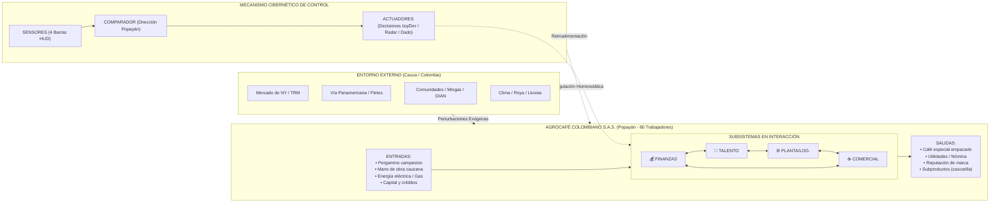
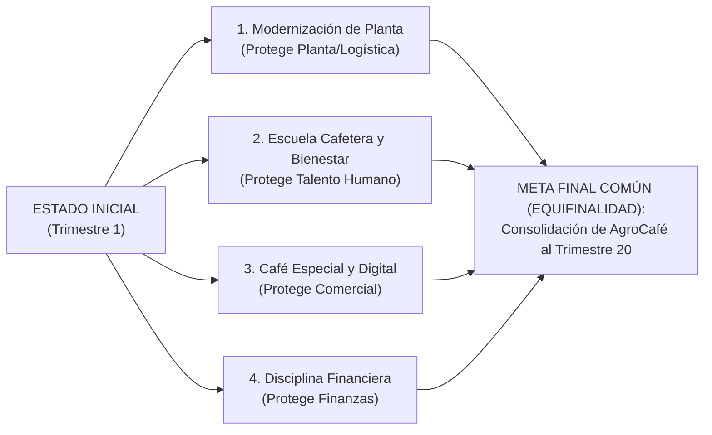
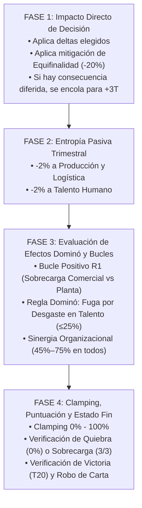

# 📖 MANUAL DE REGLAS OFICIAL
# SWIPE & SURVIVE: AGROCAFÉ COLOMBIANO S.A.S.
### Torneo de Sistemas — Asignatura: Teoría General de Sistemas (Segundo Corte)
**Integrantes:** Jhean Marlon Piamba Mamian | Santiago Vivas Sanchez | Kevin Castillo  

---

## 1. PROPÓSITO DEL JUEGO Y CONCEPTO SISTÉMICO

**Swipe & Survive: AgroCafé Colombiano S.A.S.** es un simulador interactivo de toma de decisiones estratégicas que aplica los conceptos fundamentales de la **Teoría General de Sistemas (TGS)** y la **Cibernética Organizacional**.

El objetivo no es acumular recursos de manera aislada, sino **pensar sistémicamente**: comprender que ninguna decisión gerencial es neutral, que las acciones locales generan repercusiones globales en otros subsistemas, que existen retrasos temporales entre causas y efectos, y que la supervivencia de la organización depende de su capacidad homeostática frente a los choques del entorno.

---

## 2. DEFINICIÓN FORMAL DEL SISTEMA AGROINDUSTRIAL

AgroCafé Colombiano S.A.S. es modelada como un **sistema sociotécnico abierto, complejo y autorregulado**:

### Componentes Sistémicos Principales:
1. **Entorno:** Mercado internacional del café (Bolsa de Nueva York), volatilidad de la TRM, corredor logístico de la Vía Panamericana (Popayán–Cali–Buenaventura), gremios camioneros, comunidades indígenas, políticas de la DIAN y variabilidad climática del Macizo Caucano.
2. **Entradas (*Inputs*):** Café pergamino seco comprado en veredas de Cajibío, Timbío y La Sierra; fuerza laboral de 80 trabajadores; energía eléctrica de la CEO; maquinaria y flujo financiero.
3. **Procesos (*Throughputs*):** Control de calidad y catación, trilla, tueste por lotes, molienda, empaque al vacío con sello de origen Cauca, gestión de talento humano, nómina y despacho logístico.
4. **Salidas (*Outputs*):** Café especial distribuido en supermercados y cafeterías gourmet de Colombia, divisas de exportación, bienestar laboral de los trabajadores, pago oportuno a pequeños caficultores y residuos orgánicos.
5. **Mecanismo Cibernético:** 
   * **Sensores:** 4 barras en el HUD superior que miden en tiempo real el porcentaje de salud de cada subsistema (0%–100%).
   * **Comparador:** Diagnóstico inteligente de Dirección Estratégica que identifica si el sistema está en Homeostasis (35%–75%), en Sinergia (45%–75%) o en Sobrecarga R1.
   * **Actuadores:** Decisiones dicotómicas de cada tarjeta (Izquierda vs. Derecha), inyecciones de neguentropía y herramientas de control (Radar Cibernético y Dado Fortuito).

---

## 3. LOS 4 SUBSISTEMAS INTERDEPENDIENTES (HUD SUPERIOR)

El jugador debe monitorear y regular simultáneamente 4 indicadores críticos:

| Indicador | Subsistema Representado | Área Funcional en Popayán | Efecto Crítico al 0% |
| :---: | :--- | :--- | :--- |
| **💰 FINANZAS** (`liquidity`) | **Subsistema Financiero** | Presupuesto, tesorería, flujo de caja, pago de nómina y compra de pergamino. | **Quiebra Inmediata:** Falta de liquidez para operar y pagar a caficultores. |
| **👥 TALENTO** (`morale`) | **Subsistema Social/Humano** | Clima laboral, bienestar, seguridad y turnos de los 80 operarios de planta. | **Parálisis Laboral:** Huelga de trabajadores y renuncia masiva de personal clave. |
| **☕ COMERCIAL** (`demand`) | **Subsistema Comercial** | Clientes, supermercados, cafeterías aliadas, e-commerce y lealtad de marca. | **Colapso de Ventas:** Pérdida total de demanda y retiro de contratos comerciales. |
| **⚙️ PLANTA/LOG.** (`tech`) | **Subsistema Técnico/Operativo** | Trilladoras, tostadoras industriales, bodegas y flota de camiones en el Cauca. | **Avería Total:** Colapso físico de maquinaria o interrupción total de despachos. |

> **Zonas de Operación:**
> * `0%`: **COLAPSO OPERATIVO (Fin de partida inmediato).**
> * `1% – 34%`: **Zona de Alerta Crítica (Vulnerabilidad entrópica severa).**
> * `35% – 75%`: **ZONA DE HOMEOSTASIS (Equilibrio sistémico óptimo: +50 pts/turno).**
> * `45% – 75%`: **ZONA DE SINERGIA ORGANIZACIONAL (Alta sincronía: +75 pts y +3% Caja/turno).**
> * `76% – 100%`: **Zona de Saturación / Riesgo de Sobrecarga Desincronizada.**

---

## 4. MODOS DE JUEGO

El juego se adapta tanto a juego individual como cooperativo:

* **MODO 1 JUGADOR (Gerente General):** Un solo jugador asume la Dirección General, tomando de forma holística todas las decisiones trimestrales para armonizar los 4 subsistemas.
* **MODO 2 A 4 JUGADORES (Junta Directiva):** Cada jugador asume la vocería de un subsistema de forma rotativa según el trimestre:
  * **Turno 1 / 5 / 9 / 13 / 17:** Jugador 1 lidera como **Director Financiero (CFO)**.
  * **Turno 2 / 6 / 10 / 14 / 18:** Jugador 2 lidera como **Directora de Talento Humano (CHRO)**.
  * **Turno 3 / 7 / 11 / 15 / 19:** Jugador 3 lidera como **Director Comercial y Mercadeo (CMO)**.
  * **Turno 4 / 8 / 12 / 16 / 20:** Jugador 4 lidera como **Director de Operaciones y Logística (COO)**.
  * *Mecánica deliberativa:* El director de turno tiene el voto final de decisión, pero debe debatir con sus colegas para no arruinar el subsistema del siguiente turno.

---

## 5. FASE INICIAL: PRINCIPIO DE EQUIFINALIDAD (4 RUTAS)

Antes de iniciar la simulación, los jugadores seleccionan su **Ruta Estratégica de Equifinalidad** (demostrando que un sistema abierto puede alcanzar el mismo estado final de éxito a través de condiciones iniciales y caminos distintos):

* **Ruta 1 (Modernización de Planta y Logística):** Amortigua un **20% de las caídas** sufridas en Producción y Logística (`tech`).
* **Ruta 2 (Bienestar y Escuela Cafetera):** Amortigua un **20% de las caídas** sufridas en Talento Humano (`morale`).
* **Ruta 3 (Café Especial y Canales Digitales):** Amortigua un **20% de las caídas** sufridas en Comercial y Mercadeo (`demand`).
* **Ruta 4 (Disciplina de Costos y Rentabilidad):** Amortigua un **20% de las caídas** sufridas en Finanzas y Liquidez (`liquidity`).

---

## 6. DINÁMICA DEL TURNO: PIPELINE DE RESOLUCIÓN EN 4 FASES

Cada turno representa un **Trimestre de Operación** y es resuelto automáticamente por el motor de simulación en 4 fases estrictas:

1. **Fase 1 (Impacto Directo y Encolado Diferido):** Se aplican los efectos de la opción elegida. Si la opción protege el subsistema afin a la Equifinalidad elegida, mitiga el impacto negativo en un 20%. Si la opción contiene una **Deuda Sistémica**, se encola para activarse exactamente 3 trimestres en el futuro (`Trimestre actual + 3`).
2. **Fase 2 (Entropía Pasiva Trimestral):** Siguiendo el segundo principio de la termodinámica en los sistemas abiertos, la organización sufre un desgaste continuo: **-2% en Planta** y **-2% en Talento Humano** cada trimestre a menos que se inyecte neguentropía.
3. **Fase 3 (Efectos Dominó y Bucles Cibernéticos):**
   * **Bucle Positivo R1 (Sobrecarga Operativa):** Si `Comercial >= 80%` mientras `Planta <= 35%` o `Talento <= 35%`, el sistema entra en sobreventa descontrolada. Se detona un castigo en cadena de `-12% Comercial`, `-10% Finanzas`, `-8% Talento` y suma `+1` al contador de sobrecarga.
   * **Efecto Dominó por Desgaste Laboral:** Si `Talento <= 25%`, el agotamiento de los 80 operarios provoca errores y averías en cadena, restando `-8% adicional a Planta y Logística`.
   * **Bono de Sinergia:** Si los 4 subsistemas se encuentran entre `45%` y `75%`, el sistema produce sinergia positiva: otorga `+3% en Finanzas` y `+75 pts` de bonificación.
4. **Fase 4 (Ajuste y Verificación de Fin):** Clamping de valores en rango `0%–100%`. Si alguna barra toca `0%` o el contador de sobrecarga llega a `3`, la partida termina en Derrota. Si se completa el Trimestre 20, se alcanza la Victoria.

---

## 7. MECÁNICAS ESPECIALES CIBERNÉTICAS

### A. Control Anticipativo: Radar Cibernético (*Feedforward* 🔍)
* El jugador cuenta con **3 cargas de Radar** por partida.
* Al presionar el botón `[ 🔍 RADAR ]`, se activan los paneles laterales que revelan los **porcentajes cuantitativos exactos** de cada opción antes de confirmar la decisión.
* **Detección de Deuda Diferida:** Advierte si una alternativa atractiva oculta una trampa que estallará 3 trimestres más tarde.

### B. Demoras Temporales: Desplazamiento del Problema (+3 Trimestres ⏳)
* En TGS, las soluciones facilistas de corto plazo suelen crear problemas peores diferidos en el tiempo.
* *Ejemplos del juego:*
  * Omitir el mantenimiento de la tostadora en T1 para ahorrar plata dispara la tarjeta **"Avería Catastrófica de Tostadora"** en T4.
  * Exigir turnos dobles sin pagar recargos en T2 dispara el **"Paro de Planta y Bloqueo de 80 Operarios"** en T5.
  * Despachar café húmedo fuera de norma en T3 dispara la **"Devolución Masiva y Pérdida de Supermercados"** en T6.

### C. Choques del Entorno Caucano (Crisis Aleatorias 🚨)
* El entorno exterior genera perturbaciones estocásticas en **4 momentos clave**: Trimestres **5, 10, 15 y 17 o 18** (este último adelantado para aumentar la exigencia de adaptación).
* En cada partida se eligen **4 eventos aleatorios sin repetir** de un banco de 10 crisis de la región caucana:
  1. *Premio Nacional de Taza:* Pico masivo de demanda comercial que tienta a sobrecargar la planta.
  2. *Cierre en Vía Panamericana:* Deslizamiento entre Popayán y Cali; fletes disparados.
  3. *Ola Invernal y Brote de Roya:* Lluvias en la meseta reducen cosecha y encarecen pergamino.
  4. *Exigencia de Sello Sostenible:* Cadenas exigen empaque compostable y certificación ambiental.
  5. *Minga Indígena en Variante Norte:* Bloqueo de camiones provenientes de Cajibío y Piendamó.
  6. *Alza de TRM y Especulación en NY:* Retención de café por parte de caficultores en Timbío.
  7. *Apagón en Subestación Popayán:* Corte eléctrico industrial de la CEO que detiene tostadoras.
  8. *Paro Camionero a Buenaventura:* Contenedores de exportación bloqueados en carretera.
  9. *Auditoría Tributaria de la DIAN:* Requerimiento por compras rurales no bancarizadas.
  10. *Escasez de Recolectores en el Macizo:* Grano maduro en La Sierra y Rosas en riesgo de pérdida.

### D. El Dado de la Suerte (Eventos Fortuitos 🎲)
* **Condición de Desbloqueo:** Se activa al alcanzar **1.200 puntos** en el marcador.
* **Uso Estratégico Único:** Se almacena en el inventario del HUD superior `[ 🎲 DADO ! ]`. El jugador puede reservarlo y lanzarlo **una sola vez en toda la partida** en el momento de mayor apuro.
* **Las 6 Caras del Dado:**
  * **Cara 1:** Clima Favorable en la Meseta (`+14% Op.`, `+8% Com.`, `+6% Fin.`)
  * **Cara 2:** Alianza de Comercio Justo en Caldono (`+16% Tal.`, `+10% Com.`, `-6% Fin.`)
  * **Cara 3:** Endurecimiento Crediticio y Cartera (`-16% Fin.`, `-6% Op.`, `-4% Tal.`)
  * **Cara 4:** Foco de Broca en Lotes Vecinos (`-12% Op.`, `-8% Fin.`, `-6% Tal.`)
  * **Cara 5:** Tendencia Viral de Café Caucano (`+18% Com.`, `+12% Fin.`, `-8% Op.`)
  * **Cara 6:** Donación de Maquinaria Suiza (`+18% Op.`, `+10% Tal.`, `+8% Fin.`)

---

## 8. SISTEMA DE PUNTUACIÓN Y AUDITORÍA FINAL DOCENTE

### Cálculo del Score
$$\text{Score Turno} = 100 \text{ (Supervivencia)} + [50 \text{ si Homeostasis}] + [75 \text{ si Sinergia}] - [40 \text{ si Sobrecarga R1}]$$
$$\text{Bono Final de Victoria} = +300 \text{ pts al superar el Trimestre 20.}$$

### Rangos de Desempeño
* **Rango A+ (Gerente Emérito - Score ≥ 3.000 pts):** Control homeostático perfecto, sinergia constante y dominio de retroalimentaciones.
* **Rango A (Líder Sistémico - 2.400 a 2.999 pts):** Excelente visión holística y capacidad de anticipación.
* **Rango B (Gestor de Crisis - 1.800 a 2.399 pts):** Supervivencia con desbalances moderados en la planta o las finanzas.
* **Rango C (Superviviente Entrópico - < 1.800 pts):** Sistema al borde del colapso continuo.
* **Rango D (Quiebra Operativa):** Colapso antes de culminar los 20 trimestres.

### El Informe de Auditoría Final (5 Pestañas de Aprendizaje)
Al terminar la partida (sea en victoria o derrota), se despliega el panel de análisis para sustentación docente:
1. **★ RESUMEN:** Estado final, causa del colapso o éxito, y barras de subsistemas resultantes.
2. **1. VENTAJA INICIAL:** Análisis de cómo la Equifinalidad elegida mitigó los impactos a lo largo del tiempo.
3. **2. HOMEOSTASIS:** Registro de trimestres en equilibrio homeostático y bonos de sinergia capitalizados.
4. **3. BUCLES:** Mapeo de bucles reforzadores destructivos (R1) y acciones de regulación negativa (B1).
5. **4. TOP DECISIONES:** Trazabilidad causal de las 3 decisiones de mayor impacto sistémico tomadas durante la partida.

---

## 9. REGLA DE ORO DEL JUGADOR

> **"En AgroCafé Colombiano S.A.S., no busques maximizar una sola barra. La grandeza de un gerente sistémico radica en mantener la armonía de todos los subsistemas ante el caos del entorno."**
